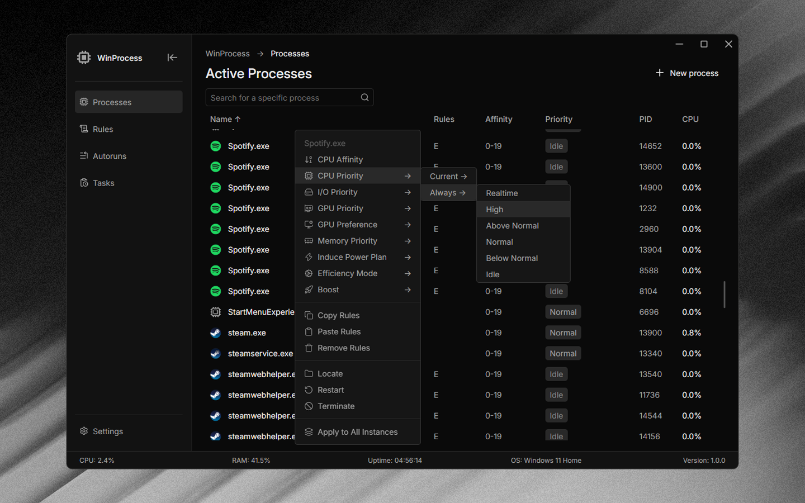

# WinProcess

<a href="https://github.com/flick9000/winprocess/releases/latest"><picture><source media="(prefers-color-scheme: dark)" srcset="https://www.shieldcn.dev/github/release/flick9000/winprocess.svg?variant=outline&amp;size=sm&amp;mode=dark"></picture></a>
<a href="https://github.com/sponsors/flick9000"><picture><source media="(prefers-color-scheme: dark)" srcset="https://www.shieldcn.dev/badge/Sponsor-GitHub.svg?logo=githubsponsors&amp;variant=outline&amp;size=sm&amp;mode=dark"></picture></a>
<a href="https://ko-fi.com/flick9000"><picture><source media="(prefers-color-scheme: dark)" srcset="https://www.shieldcn.dev/badge/Ko--fi-sponsor.svg?logo=kofi&amp;variant=outline&amp;size=sm&amp;mode=dark"></picture></a>

**Process management, system optimization, and task management in one lightweight Windows app.**

WinProcess lets you monitor running processes, adjust CPU/GPU/I/O/memory priorities and CPU affinities, switch power plans automatically, configure persistent rules, manage startup applications, and handle scheduled tasks, all without jumping between different Windows tools.

## Features

### Process Management

Fine-tune how individual applications use system resources.

- CPU Affinity: Choose which CPU cores a process can use.
- CPU Priority: Adjust process scheduling priority.
- I/O Priority: Configure process I/O priority.
- GPU Priority: Set the GPU scheduling priority of a process, from idle to realtime.
- GPU Preference: Choose which GPU Windows uses for an app.
- Memory Priority: Adjust memory priority.
- Induce Power Plan: Automatically switch to a chosen power plan while a specific app is running.
- Efficiency Mode: Manage Windows efficiency mode.
- Boost: Manage dynamic thread priority boost.

### Persistent Rules

Create rules that are applied automatically whenever a program starts. There's no need to configure the same process every time you launch it.

### Startup Management

Manage Windows startup apps directly from WinProcess.

- View and manage startup applications.
- Keep unwanted applications from launching automatically.
- Manage autorun entries.

### Scheduled Task Manager

Manage Windows Scheduled Tasks directly from WinProcess.

- Keep track of background tasks and their schedules.
- Enable or disable scheduled tasks.
- Run tasks on demand.

## Contributing

WinProcess is open source, and contributions are welcome. Whether you want to fix a bug, suggest a feature, or contribute code, every contribution is appreciated.

1. Fork the repository.
2. Create a new branch for your changes.
3. Make your changes.
4. Submit a pull request.

Found a bug or have an idea? [Open an issue](https://github.com/flick9000/winprocess/issues).

## Support

- **Star the repo** to help the project reach more people.
- **Donate**: if you find WinProcess helpful, you can [buy me a coffee](https://ko-fi.com/flick9000).

## License

WinProcess is licensed under the **GPL v3 license**. See [LICENSE](LICENSE) for more details.
